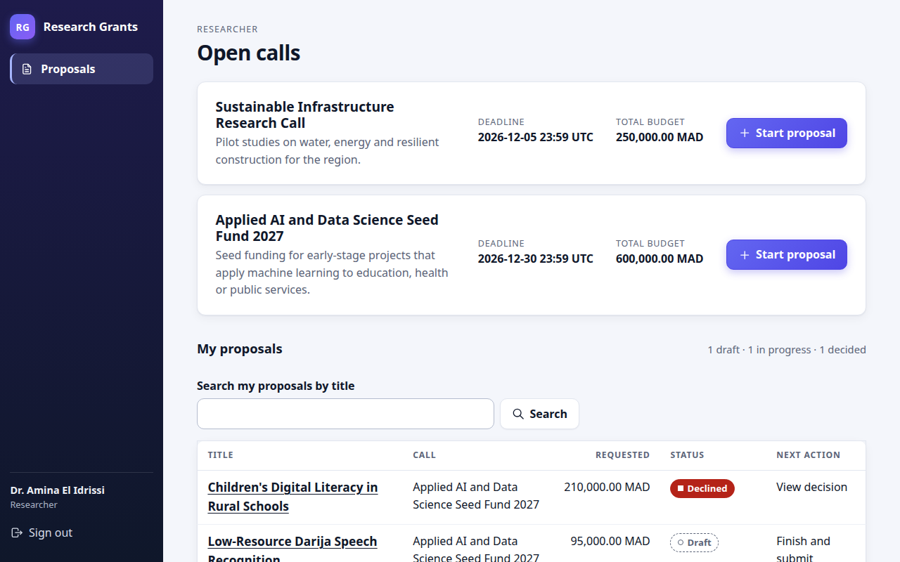
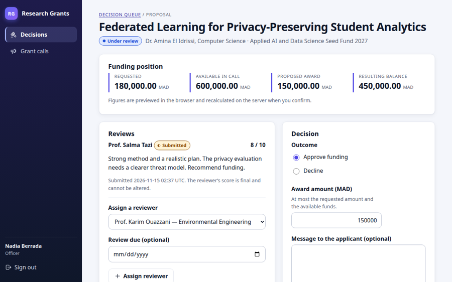
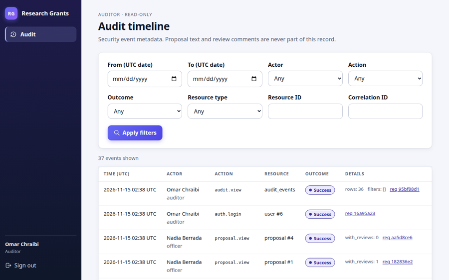
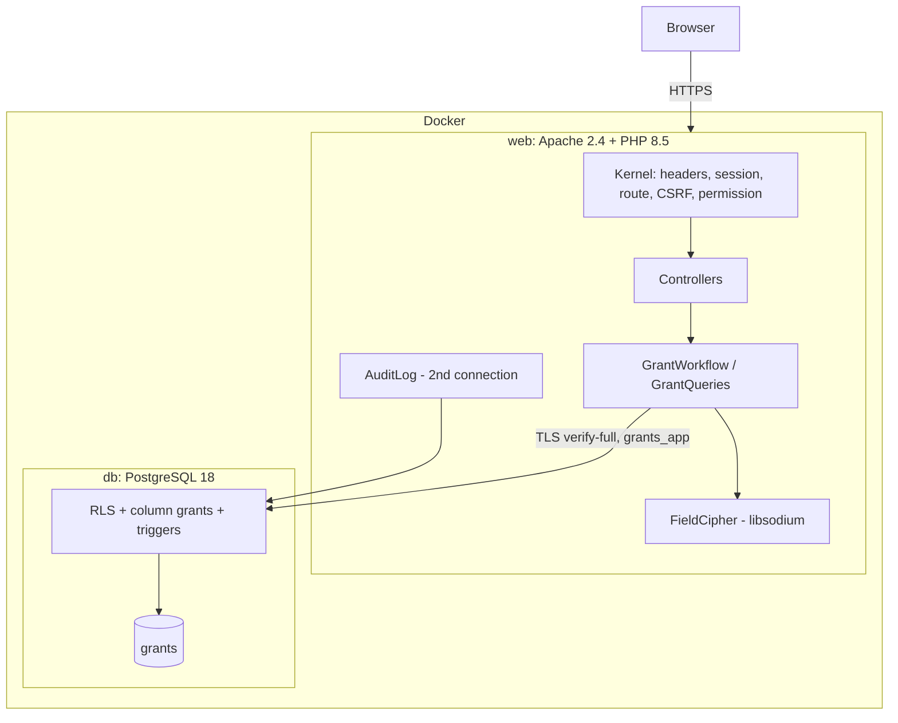
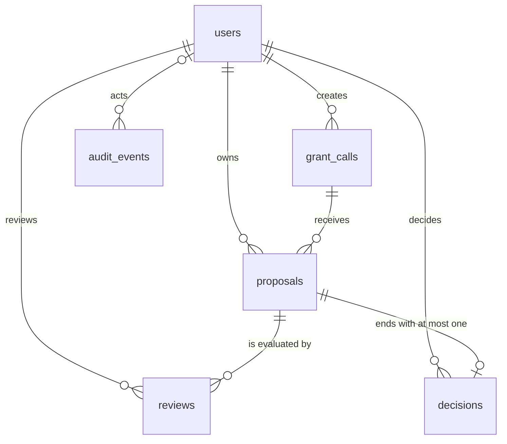

<div align="center">

# 🎓 University Research Grant Management System

**A security-first platform for the full grant life cycle: call → proposal → peer review → funding decision → audit.**


[](https://github.com/Abdelghany32/research-grants-management/actions/workflows/ci.yml)


</div>

<p align="center">
  
  
  
</p>
<p align="center"><sub>Researcher inbox · Officer decision with live balance preview · Read-only auditor timeline</sub></p>

> A Database Security Engineering project. All people, e-mail addresses and proposals are **fictional**.

## Table of contents

[Features](#-features) · [Architecture](#-architecture) · [Data model](#-data-model) · [Security model](#-security-model) · [Quick start](#quick-start) · [Testing and pentest](#-testing-and-penetration-testing) · [Roadmap](#-roadmap-and-improvements) · [Documentation](#-documentation) · [License](#-license)

## ✨ Features

| Role | What they do |
| --- | --- |
| 🧑‍🔬 **Researcher** | Browse open calls, save drafts, submit proposals, follow status and read the final decision |
| 📝 **Reviewer** | See only assigned proposals, score 1–10, write encrypted confidential comments |
| 🏛️ **Grants officer** | Publish calls, assign reviewers (with deadlines they can extend), approve (with amount) or decline; the budget is reduced atomically |
| 🔍 **Auditor** | Read-only timeline of who did what, when, and with what result, including denied attempts; **CSV export** of the filtered timeline |

Highlights: individual accounts with **Argon2id** and **two-step sign-in (TOTP or phishing-resistant security keys)** for officers and auditors, a separate **identity service** so the web process never holds the actor key or a password hash, authorization enforced in **PHP and PostgreSQL (RLS)** with an **identity the database itself verifies** (signed actor token), the funding award as **one atomic database function**, **libsodium** field encryption with a **rotatable keyring**, per-address login throttling, an **audit trail only a separate account can write**, **review deadlines enforced by the database**, **e-mail notifications through a database outbox** that carry no confidential content, **encrypted backups** (key backed up apart, private key under separate custody) with a verified recovery drill, **pgaudit** and **tamper-evident log shipping**, **CI** on every push, and a responsive, keyboard-accessible interface with light/dark themes.

## 🏗 Architecture



Every request passes the same ordered checks: `security headers → session → route → CSRF → login → permission → controller → database (RLS)`.

## 🗄 Data model



Full column-level diagram: [docs/ERD.md](docs/ERD.md).

## 🔐 Security model

| Layer | Control |
| --- | --- |
| Authentication | Argon2id; **second factor** for officers and auditors: TOTP (encrypted secret, single-use recovery codes, replay protection) or a **WebAuthn security key** (public key only, signature counter against cloned keys, bound to this site's origin); failures counted per (account, source address), per-address throttle (HTTP 429), equal hashing work on every failed path; session regeneration, idle expiry, CSRF token on every POST |
| Authorization | Route permission in PHP **and** Row-Level Security in PostgreSQL; the acting user is **proved to the database** by an HMAC-signed, 2-minute actor token, so a stolen database password cannot claim an identity |
| Least privilege | Web app uses a non-owner, non-superuser role with column-level grants; owner role is `NOLOGIN`; it cannot insert a decision or edit a budget (only `record_decision()` can) |
| Integrity | `numeric` money, the award is one `SECURITY DEFINER` function under a row lock, one decision per proposal, immutable submissions, **review deadlines enforced by a trigger** (only an officer extends, only forwards) |
| Data protection | Review comments encrypted in PHP (keyring with key ids and rotation); TLS to the database; OpenPGP-encrypted backups, key backed up separately |
| Auditing | Append-only events written only through `audit_append()`; the web account has no write privilege, a **separate account** records unauthenticated events (flagged *unverified*); denials survive rollback; CSV export is itself audited |
| Database audit | `scripts/check-db-security.sh` asks the PostgreSQL catalogs 29 questions (one superuser, SCRAM everywhere, no PUBLIC privilege, RLS and pinned `search_path` on definer functions, TLS, pgaudit, no clear-text sensitive column) and writes `docs/evidence/db-security.txt` |
| Process isolation | The web front end holds **no actor key, no audit-writer/identity credential and cannot read password hashes** (O01 closed); an **identity service** on an internal network does sign-in and vouches for sessions; `scripts/check-isolation.sh` proves it in the running stack (37 checks) |
| Monitoring | **pgaudit** records DDL, role changes and writes (and everything the superuser or schema owner does); PostgreSQL and application logs are shipped to an **append-only, hash-chained archive** that nothing else can write (`scripts/check-logship.sh`, 20 checks) |
| Hardening | Single web root, security headers (CSP, HSTS, Permissions-Policy, COOP/CORP), private network, no published DB port, six least-privilege database accounts, **CI with an image vulnerability scan** |

### Manual testing

```bash
scripts/manual-test.sh            # starts the stack if needed, prints demo accounts, passwords and the CURRENT two-step codes, opens the browser
scripts/manual-test.sh codes     # live two-step codes for the officer and the auditor
scripts/manual-test.sh --reset   # rebuild the demo data first
```

The script also prints a 20-minute checklist (create and submit a proposal, assign, review, decide, read the audit trail, try the role walls, add and use a security key).

## 🧪 Testing and penetration testing

| Check | Result |
| --- | --- |
| Integration tests (real PostgreSQL) | **89 tests, 968 assertions, 0 failed** + 13 owner-level guard checks |
| Interface checks (responsive, focus, colour independence, login throttle, two-step, deadlines, export) | **28 passed**, 33 screenshots |
| Concurrent award (two processes, one budget) | exactly one wins |
| Isolated pentest campaign (11 Nov) | **115 attacks resisted**; 5 findings (F01-F05) + 3 conditional observations |
| **Remediation and retest (17 Nov)** | **F01-F05 and observations O02 and O03 fixed and retested with the original probes**; black-box rerun: **122 resisted, 0 findings** |
| Controlled SQL injection lab | unsafe query leaks 7 accounts, nothing else; the same 9 payloads return 0 rows after the fix |
| Key rotation drill | add key, old data still readable, unsafe retirement refused, re-encrypt, retire |
| Backup → loss → restore drill | 0.8 s, 8 checks (28 assertions), key backup identical; identity binding, second factor and outbox verified after restore |
| Incidents | unauthorized read + legitimate award; **stolen service credential: the attacker now gets nothing but the account list** (before/after evidence) |
| Clean-room install | fresh copy, no secrets: setup + all tests pass in under a minute |
| CI | every push and pull request: syntax, tests, labs, pentest retest, recovery drill, image build and patch-status report |

The pentest ran against a disposable copy of the app and the retest against the lab. It is a bounded lab campaign, **not** a security certification. Observation **O01** is closed by the identity split. What remains is stated in the [report](docs/PROJECT_REPORT.md#14-final-assessment-limitations-and-recommendations).


## 📦 Container image (GitHub Packages)

The hardened web image (Apache 2.4 + PHP 8.5 + `pdo_pgsql`, no application code or secrets inside) is built and
published by GitHub Actions to `ghcr.io/abdelghany32/research-grants-management-web` (tags `latest` and the commit SHA).

A second image, the **database** (PostgreSQL 18 with `pgaudit` preloaded), is published next to it as
`ghcr.io/abdelghany32/research-grants-management-db`. Both are rebuilt when `docker/web`, `docker/db` or `src` change.

```bash
docker pull ghcr.io/abdelghany32/research-grants-management-web:latest
docker pull ghcr.io/abdelghany32/research-grants-management-db:latest
```

## 📚 Documentation

| Document | Content |
| --- | --- |
| [docs/PROJECT_REPORT.md](docs/PROJECT_REPORT.md) | **Full project report**: objectives, architecture, screenshots, pentest, recovery |
| [docs/Database_Security_Assessment_Report.pdf](docs/Database_Security_Assessment_Report.pdf) | **Database Security Assessment Report** in the 22-section structure required by the assignment, with appendices (58 pages: 22 sections, 33 figures, 25 screenshots, appendices; source: `docs/latex/report.tex`) |
| [docs/pentest/WRITEUP.md](docs/pentest/WRITEUP.md) | Detailed penetration-test write-up, with the retest addendum |
| [docs/ERD.md](docs/ERD.md) | Entity-relationship diagram |

## 🧰 Tech stack

| Component | Version actually used |
| --- | --- |
| PostgreSQL | 18.7 (`postgres:18` image, rebuilt 17 Nov) |
| PHP | 8.5.12 with PDO_PGSQL, sodium, Argon2id (`php:8.5-apache` image) |
| Apache | 2.4.69, mod_php, mod_ssl |
| Host | Ubuntu 26.04, Docker 29.1.3, Docker Compose 2.40.3 |
| Front end | Server-rendered HTML, one CSS file, one small JavaScript file, Tabler Icons v3.51.0 (MIT) |

## Quick start

```bash
scripts/setup.sh          # generates local secrets, builds, creates roles/schema, seeds demo data
```

Open <https://localhost:8443> and accept the self-signed certificate warning.
Demo logins are generated on your machine in `secrets/demo-credentials.txt` (e-mail, tab, password). Officers and auditors are also asked for a **6-digit code**: the demo secrets are in `secrets/demo-totp.txt`, and `scripts/totp.py <e-mail>` prints the current code.
Nothing in `secrets/` is ever committed.

| Task | Command |
| --- | --- |
| Run every test (rebuilds `grants_test` first) | `scripts/test.sh` |
| Run some tests | `scripts/test.sh RLS` (name filter: AUTH, RBAC, RLS, FLOW, DATA, AWARD, AUDIT) |
| Reset the demo data | `scripts/db-apply.sh grants --reset && scripts/seed.sh grants` |
| Encrypted backup (+ field-key backup) | `scripts/backup.sh` → `backups/grants-<UTC>.dump.gpg` and `.fieldkey.gpg` |
| Restore into a separate database | `scripts/restore.sh backups/<file>.dump.gpg grants_restore` |
| Full backup → loss → recovery → verification drill | `scripts/recovery-drill.sh` |
| Simulated incident (denied read, then a legitimate award) | `scripts/incident-demo.sh` |
| Collect psql privilege and hardening evidence | `scripts/evidence.sh` |
| Controlled SQL injection lab (before / impact / after) | `scripts/sqli-demo.sh` |
| Stolen-credential incident, investigated from the audit trail and the PostgreSQL log | `scripts/incident-privileged.sh` |
| Field-key lifecycle (status, add, reencrypt, retire) | `scripts/rotate-field-key.sh status` · `scripts/key-rotation-drill.sh` |
| Backup private-key custody (protect, export, remove, import) | `scripts/backup-key.sh status` · `scripts/backup-key-custody-demo.sh` |
| Replay the F02-F05 probes | `python3 scripts/pentest/retest-auth.py` |
| Current TOTP code for a demo officer or auditor | `scripts/totp.py nadia.berrada@uni.example` |
| Reset one person's second factor (operator, audited) | `scripts/mfa-reset.sh <e-mail>` |
| Deliver the e-mail outbox now (the `notifier` service does it every minute) | `docker compose exec web php scripts/send-notifications.php --reminders` · files in `logs/outbox/` |
| Bring an existing database to this release (keeps data) | `scripts/db-apply.sh grants` |
| Screenshots and interface checks (needs Chrome and Node) | `node scripts/screenshots.mjs` |
| Build from tracked files only, on other ports | `scripts/clean-room-check.sh` |
| psql as administrator | `docker compose exec -u postgres db psql grants` |
| Stop / remove everything including data | `docker compose down` / `docker compose down -v` |

## Where things are

```
public/            the only web root: index.php + local CSS, JS, icon sprite
src/Http/          Kernel.php (route table, CSRF, login, permission) and controllers
src/Auth/          Authenticator, Session, Csrf, Policy, Totp, WebAuthn + Cbor (security keys)
src/Identity/      identity service (HTTP wrapper around Authenticator), client, remote authenticator
src/Grants/        GrantWorkflow (every write), GrantQueries (every read), Money
src/Database/      Database::asActor() - sets the actor for one transaction
src/Audit/         AuditLog (through audit_append) and AuditReader (auditor account)
src/Mail/          Notifier, mailers (file, SMTP), message builder
.github/           CI workflow, retest checker, Dependabot
src/Security/      FieldCipher - encrypts review comments (keyring, key ids)
templates/         HTML only, no queries
database/          00_database 01_roles 02_schema 03_rls 05_remediation 06_identity_and_audit 07_review_deadlines 08_mfa 09_notifications 10_identity_split 11_webauthn 12_pgaudit 04_grants (.sql), seed_users.tsv
scripts/           setup, seed, test, backup, restore, drills, evidence
tests/             test runner, 89 tests against real PostgreSQL, owner_guards.sql
docker/            Dockerfile, Apache vhost, php.ini, pg_hba.conf, PostgreSQL settings
docs/              PROJECT_REPORT.md, ERD.md, pentest/WRITEUP.md, evidence/, images/
secrets/ backups/ logs/   local only, ignored by Git
```

## Following one button to the database

"Confirm decision" on the officer screen:

1. `templates/officer/decision.php` posts to `/officer/proposals/{id}/decision` with a CSRF token (the officer signed in with a password **and** a one-time code).
2. `src/Http/Kernel.php` finds the route, checks the token, the session and the `decision.record` permission.
3. `OfficerController::decide()` calls `GrantWorkflow::recordDecision()`; the database connection presents a **signed actor token** for the officer, which PostgreSQL verifies itself.
4. `recordDecision()` opens one transaction as the officer (`Database::asActor`) and calls the database function
   `record_decision()`, which locks the grant call row, re-checks state and money, inserts the decision, lowers
   the balance, updates the proposal and appends the audit event; the web account has no privilege to do any of
   these steps on its own.
5. PostgreSQL applies the RLS policies in `database/03_rls.sql` and the guard triggers in
   `database/02_schema.sql` to each of those statements.

See [docs/PROJECT_REPORT.md](docs/PROJECT_REPORT.md) for the security assessment.

## 📄 License

Released under the [MIT License](LICENSE).
