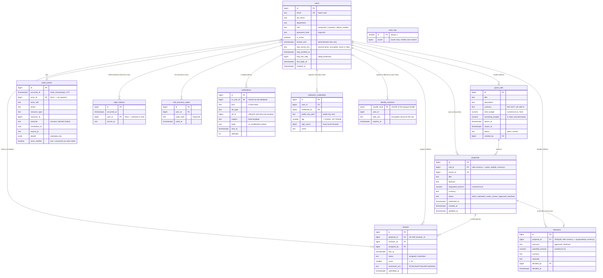

# Entity-relationship diagram and data ownership

Cardinalities: a call receives many proposals; a proposal belongs to exactly one call and one owner;
a proposal has zero or more reviews, at most one per reviewer (`UNIQUE (proposal_id, reviewer_id)`);
a proposal has at most one decision (`UNIQUE (proposal_id)`) and decision rows are created only by the database function `record_decision()`. All timestamps are `timestamptz`
with the database and both login roles pinned to UTC.

The two composite foreign keys make a currency mismatch impossible: a proposal can only carry its
call's currency, and a decision can only carry its proposal's currency.

## Ownership of sensitive fields (data classification with availability needs)

| Field | Classification | Data owner | May read | May write | Availability need |
| --- | --- | --- | --- | --- | --- |
| `users.password_hash` | Secret | The account holder | Nobody through SQL grants; `auth_find_credentials()` returns one row for one e-mail | Schema owner only (seed) | Medium: no sign-in without it |
| `users.email`, `full_name`, `department` | Personal (internal) | The person | Runtime account | Schema owner only | Medium |
| `users.role`, `is_active` | Internal, integrity-critical | Research office | Runtime account | Schema owner only | Medium |
| `users.locked_until` | Internal | Security | Runtime account (read) | Administrator only (incident response) | Low |
| `proposals.title`, `abstract` | Confidential (unpublished research) | The researcher | Owner; assigned reviewers and officers once submitted | Owner while draft | **High** before a deadline |
| `proposals.requested_amount` | Confidential | The researcher | Same as abstract | Owner while draft | High |
| `reviews.score` | Confidential | The reviewer | The reviewer, officers | The reviewer until final | Medium |
| `reviews.comments_enc` | Restricted (private notes) | The reviewer | The reviewer, officers; ciphertext to everyone else including DBAs and backups | The reviewer until final | Medium; unreadable if the key is lost |
| `decisions.outcome`, `awarded_amount`, `rationale` | Confidential, integrity-critical | Grants office | Officers; the proposal owner | **Only `record_decision()`**, once per proposal | High |
| `grant_calls.remaining_budget` | Internal, integrity-critical | Grants office | Workflow roles | **Only `record_decision()`** (lowers it) | High |
| `login_failures.*` | Internal (security) | Security | Nobody directly; three `SECURITY DEFINER` functions | The same functions | **High**: a flawed design lets an attacker lock people out |
| `audit_events.*` | Restricted (security record) | Internal audit | Auditor account through `audit_timeline` | Append-only by the runtime account (observation O03) | Medium |
| Field keyring, backup private key, DB passwords | Secret | System administrator | Files under `secrets/`, mode 0600 | Generated by `scripts/setup.sh` / `backup.sh`; keyring changed by `rotate-field-key.sh` | High |
| `users.totp_secret_enc` | Secret | The account holder | Nobody through SQL; `mfa_state()` with the user's own token | `mfa_enroll()` once, with the user's own token (operator reset: `scripts/mfa-reset.sh`) | Medium |
| `mfa_recovery_codes.code_hash` | Secret (Argon2id) | The account holder | Nobody (functions only) | `mfa_enroll()`, `mfa_consume_recovery()` | Low |
| `webauthn_credentials.*` | Internal (public key, counter) | The account holder | Identity account through `webauthn_list()` with the owner's actor token | `webauthn_register()`, `webauthn_use()`, `webauthn_delete()` (own token; the last second factor cannot be removed) | Low |
| `identity_sessions.*` | Secret (session state) | Security | Identity account only; the web account has no privilege | Identity service; handles are stored as SHA-256, payload encrypted | High |
| `notifications.*` | Internal | Security | The notifier account | `notify_enqueue()` (actor token, own action, fixed template); the notifier marks them sent | Medium |
| `actor_key.secret` | Secret (verifies identity) | System administrator | Schema owner only | `database/06_identity_and_audit.sql` from `secrets/actor.key` | High |
| `audit_events.actor_verified` | Restricted | Internal audit | Auditor account | Set by `audit_append()` / `record_decision()`: true only for a proved actor | Medium |
| `reviews.due_at` | Internal | Grants office | Reviewer (own), officers | Set at assignment; moved forward only by an officer (trigger) | Medium |
