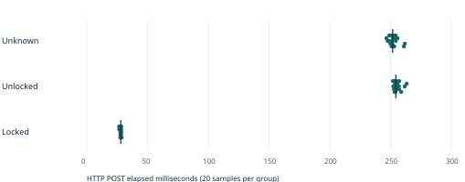

# University Grants Penetration Test Write Up

AUTHORIZED LOCAL LAB ASSESSMENT

University Research Grant Management System
Database Security Engineering project
Assessment date: 11 November 2026

This document records the penetration-testing work performed against a separate local copy of the application. It explains the scope, preparation, test methods, successful defenses, reproduced weaknesses and exact follow-up needed to close findings. It also provides the controlled SQL injection comparison required by the course assignment.

The tested copy used a separate Docker Compose project, database volume, keys and fictional credentials. The web target was https://localhost:9543. The original demonstration application remained on https://localhost:8443. Database probes ran inside the isolated web container as the restricted grants_app database account.

Results in this document come from this campaign's stored outputs. The application code was not remediated during the campaign. A deliberately vulnerable query was created only in a guarded CLI test; no vulnerable HTTP endpoint was added. A partial decision and a clearly marked fabricated audit event were committed only in the disposable test database to prove the persistence of the database-level findings.

Main outcome: the regression suite and tested HTTP authorization controls resist the exercised attacks. Authentication abuse remains observable. Restricted SQL access can also bypass the completeness of the financial operation and exploit documented service trust boundaries. These database results require an already compromised service or its SQL credentials; they are not evidence of an unauthenticated route to the database.

Source and evidence: docs/pentest/WRITEUP.md; docs/evidence/pentest/; scripts/pentest/. Read the distinction between HTTP weaknesses, internal trust boundaries and the deliberately vulnerable teaching example before interpreting severity.

**Status update, 17 November 2026.** The findings below describe the campaign of 11 November, during which the application was deliberately not changed. They have since been remediated and retested with the same probes: see the final chapter, "Retest After Remediation". Observations O02 and O03 were closed in release 2 and **O01 in release 3** (the identity service split, see below); the campaign text is kept as it was written.

# Executive Findings and Decision

### What ran
The full existing integration suite was rerun in the isolated stack: 43 tests, 296 assertions, zero failures. The baseline HTTP and network harness completed with 115 resisted checks and four findings. Additional tests verified certificate trust against the generated lab certificate, paired authorized and unauthorized reads, exercised title-search payloads, performed 60 randomized timing samples, and tested 30 further login attempts. A guarded PHP CLI script then examined SQL injection and the actual runtime account's powers.

### What was reproduced
Five actionable findings are described as F01-F05: partial financial decisions through restricted SQL, account lockout abuse, locked-account timing disclosure, lack of observed source throttling, and the missing Permissions-Policy header. Three additional observations, O01-O03, explain the credential helper, self-asserted actor identity and audit-event insertion trust. These are separately labeled because they assume SQL/service compromise and are partly inherent in the current architecture.

The most significant integrity result is a committed 1.00 award while the call balance remained 600000.00 and the proposal remained under_review. The normal workflow does all three updates correctly; the SQL grants permit the caller to perform only the first. This demonstrates a database boundary weakness without claiming an HTTP exploit chain.

### What remains unproven
No cross-user HTTP disclosure, XSS execution, login bypass or successful SQL injection in the delivered application's tested routes was demonstrated. The controlled vulnerable query is a teaching comparison, not a discovered live endpoint. No remote-host attack, denial-of-service load test, password cracking or third-party scan was performed. The test counts do not measure all possible vulnerabilities.

### Recommended decision
Preserve this baseline and remediate confirmed findings next. Prioritize the database financial operation and authentication abuse. Replay the exact original probes after each fix, then rerun the integration suite. The final security assessment remains open until these retests pass or the team explicitly documents an accepted residual risk.

Timing example: locked median 27.996 ms; unlocked median 254.366 ms, with 20 observations in each category. The observed separation is local and does not establish an Internet-wide classification threshold.

# Authorization Scope and Rules of Engagement

### Owned assets and allowed identities
The scope is the group's own fictional university grant application. Testing used generated researcher, reviewer, officer and auditor accounts in a separately initialized local copy. Requests went to localhost ports 9180 and 9543. Database-network checks originated inside the isolated web container and targeted its db service. Restricted SQL tests used grants_test in that copy.

Administrative Docker and PostgreSQL access was used for provisioning, fixture selection, counter cleanup and evidence collection. The attack step in the database tests used grants_app, not postgres. Distinguishing preparation authority from attack authority is essential: the operator's administrative access is not itself the demonstrated weakness.

### Isolation and bounded effects
The original demo was not reset or reseeded. The lab had its own Docker project name, network and PostgreSQL volume, as well as new cryptographic keys and passwords. The only application configuration adjustment in the copy changed the HTTP redirect's HTTPS port from 8443 to 9543. This is recorded as a lab deployment adjustment rather than a security fix.

The baseline HTTP script temporarily created and deleted one draft, attempted authorization violations, generated audit events and reset fictional login counters. The deeper HTTP script bounded the timing run at 60 requests and the source-throttling probe at 30 requests. The direct SQL script intentionally left a 1.00 inconsistent allocation and a marked synthetic audit row in grants_test as evidence.

### Exclusions
The university's production services, public websites, third-party databases and real accounts were excluded. No mass password list, destructive production operation, sustained availability attack or credential exfiltration was used. Passwords, hashes, session cookies, CSRF tokens and private keys were not included in report evidence.

A localhost restriction is only a scope safeguard. It does not make a script non-mutating. Repeat the campaign only in a prepared disposable stack. The temporary database records must not be merged back into the demonstration or submitted as genuine business history.

# Environment and Evidence Provenance

### Reproducible target
The lab was created by scripts/pentest/prepare-lab.py, which copies application code, SQL, templates, configuration, scripts and tests without copying secrets, logs, backups or live database data. scripts/setup.sh generated new credentials and seeded six users, two grant calls and six fictional proposals. The isolated Compose project for this execution was grantspentesty55wk0yt, with source under /tmp/grants-pentest-y55wk0yt.

The stack uses the same PHP/Apache and PostgreSQL configuration as the project. Read-only checks of the running isolated containers confirmed PHP 8.5.12, Apache 2.4.69 and PostgreSQL 18.6. Setup output and the campaign source manifest identify the copy used. A source manifest can detect later changes but is not a digital signature or independent chain of custody.

### Evidence organization
| File under docs/evidence/pentest | Meaning |
| --- | --- |
| setup.txt | Isolated stack creation and seed result |
| source-manifest.sha256 | Hashes of source files used at campaign preparation |
| regression.txt | Fresh full test suite output |
| http-baseline.txt | Baseline HTTP and database-network results |
| http-deep.json | Positive controls, TLS validation, authentication and search results |
| timing.csv | All 60 labeled timing samples, without credentials |
| deep-db.json | Controlled SQL comparison and restricted-account results |
| deep-db-initial-returning-denied.json | Initial probe stopped at a correctly denied RETURNING clause |
| http-deep-harness-error.json | Initial harness reporting error, not an application finding |

### Evidence conventions
PASS means the specific tested expectation held. CONFIRMED FINDING means the described behavior was reproduced. TRUST BOUNDARY means a capability was reproduced under the stated stronger prerequisite. PENDING means not demonstrated. A command exit of zero for the deep SQL probe means the evidence collection completed; it does not mean the application is secure. The baseline script exits one when findings are present.

Initial failed harness runs are retained instead of hidden. Their results are not included as additional vulnerabilities. The completed JSON files are the authority for the final measurements.

# Methodology and Test Sequence

### Sequence used
1. Read the project status, route table, authentication implementation, SQL grants and existing test scripts. Identify expected legitimate behavior and the assumptions behind old evidence.
2. Create an independent copy, generate new secrets and seed fictional fixtures. Confirm the target login page is reachable.
3. Run the existing integration suite on isolated grants_test and the baseline HTTP harness on isolated grants. Their evidence is retained separately.
4. Wait for the baseline work to finish before collecting the stronger authentication timing data. Use a shuffled sample order and an anonymous client with valid CSRF tokens.
5. Reseed only isolated grants_test before the direct SQL probes. Compare vulnerable and bound SQL under the same actor and unchanged RLS, then test the runtime grants.
6. Inspect successful commits and state changes, preserve artifacts and compare the original demonstration counts and balances.
7. Write findings with a reproduction, impact, root cause and retest criterion. Do not silently deploy fixes during assessment.

### Positive and negative controls
A denied request is interpretable only when the tester knows the account is valid and the resource exists. The deeper HTTP harness first signs in successfully and checks that the owner can open the target. It then requests the same resource with another account. Likewise, an apostrophe-containing legitimate search verifies that the route still works before malicious-looking strings are submitted.

For authentication, every timing sample obtains a token in the same anonymous cookie jar used for the POST. Every measured response must be 401. A redirect, CSRF rejection or connection failure stops the intended measurement rather than being called a fast password failure.

### Reference framework
The coverage follows the relevant areas of OWASP's Web Security Testing Guide: authentication, authorization, sessions, input handling, configuration and business logic. It is a tailored assessment, not a claim of full WSTG coverage or certification. PostgreSQL documentation informs interpretation of row-policy default-deny behavior and the owner/BYPASSRLS exceptions [R1-R3].

# Coverage Matrix and Execution Status

| Area | Actual test and evidence | Outcome and limit |
| --- | --- | --- |
| Exposure | Sensitive paths, traversal, methods and version headers; http-baseline.txt | Tested paths rejected; not exhaustive file discovery |
| Transport | Certificate-verified HTTPS in http-deep.json; database TLS/network probes | Local certificate verification passed; legacy refusal probes have client limitations |
| Authentication | Real login, wrong credentials, lockout, 60 timing samples, 30 attempts | Valid login works; F02-F04 reproduced |
| Session | Existing AUTH tests plus fixation/logout baseline | Tested behavior passed; no full browser theft scenario |
| CSRF | Missing/foreign token and GET logout attempts | Tested requests refused; no proof for unimplemented routes |
| Authorization | Owner/non-owner and assigned/unassigned pairs; RBAC suite | Tested routes stayed within permissions |
| SQL injection | HTTP search payloads plus CLI vulnerable/bound comparison | No tested live exploit; controlled comparison demonstrated |
| XSS | Stored/reflected payload markers and escaping regression | No raw payload in tested pages; no automated browser execution proof |
| Input tampering | Extra owner/status/currency fields and invalid money | Expected field restrictions and validation observed |
| RLS | Missing actor, reused connection, role-bound records | Tested RLS passes; actor assertion remains trusted |
| Financial integrity | Concurrent normal workflow plus direct restricted SQL | Normal workflow passes; partial SQL commit reproduced as F01 |
| Password-hash access | Direct column denial plus helper enumeration | Column blocked; helper permits six hashes under SQL compromise |
| Audit | Rollback survival, append-only restrictions, synthetic insert | Normal event controls pass; authenticity depends on service |
| Encryption | DATA suite | Selected comments encrypted and row-bound; not whole-volume encryption |
| Recovery | Prior drill reviewed, not rerun in this campaign | Historical evidence only; no fresh recovery claim |
| Final remediation | No application changes during testing | All findings remain open for retest |

The 115 resisted baseline checks include repeated endpoints and variants. Do not add them to the 296 assertions as if they represented distinct vulnerability classes. The deeper checks intentionally overlap selected baseline cases to improve confidence rather than inflate coverage.

# Reconnaissance Transport and Exposure

### Requests exercised
The baseline requested /.git/config, /.env, /config/config.php, /secrets/web.env, /backups/, /database/02_schema.sql, /src/App.php, /logs/app-error.log, /server-status, /assets/, /phpinfo.php and an editor-style backup filename. It also tried raw and percent-encoded parent-directory traversal. Expected outcomes were 400, 403 or 404 without sensitive content.

TRACE, PUT, DELETE, OPTIONS and PATCH requests to a workflow path were checked for rejection rather than interpreted as valid state changes. Anonymous requests to proposal, review, officer and auditor routes redirected to login. These checks support the single-public-root design and route-method boundaries on the exercised paths.

### Headers and TLS
The verified HTTPS request returned 200 with HSTS, Content-Security-Policy, X-Content-Type-Options, X-Frame-Options and Referrer-Policy. The Permissions-Policy header was absent. The deeper client trusted the generated local certificate explicitly and verified the localhost hostname; it did not disable certificate checking.

The older baseline uses curl -k and tests legacy TLS through openssl. A client unable to offer an obsolete protocol can look like a server rejection. Its refusal results are supporting observations, not a complete TLS cipher assessment. No external certificate-chain or public domain deployment exists in this scope.

### Database-network boundary
From the web container, the baseline attempted superuser network access, a guessed runtime password, runtime access without TLS, backup-role network access and runtime access to the postgres database. The expected password or pg_hba rejection was observed. The database's lack of a published host port reduces direct access but does not protect it from its authorized web client.

### Limits
A sensitive-file status code does not prove the entire filesystem is inaccessible; the selected paths should be rechecked after Apache configuration changes. The header test did not demonstrate browser-feature abuse. Missing Permissions-Policy is therefore ranked below the financial and authentication findings.

# Authorization Sessions and Input Controls

### Horizontal and vertical authorization
The deeper HTTP test opened Amina's draft as its owner and received 200, then opened the same identifier as Youssef and received 404 without the draft title. Karim's reviewer list returned 200, while a colleague's assignment returned 404. These pairs reduce the risk that a nonexistent resource or failed login explains the denial.

The baseline additionally attempted another researcher's edit, submit and delete actions, direct officer decision and assignment URLs, and review modification by an unassigned reviewer. The regression suite checks the human permission matrix, cross-role pages, direct workflow methods and RLS queries. These results support the tested boundaries; they do not establish that every possible future endpoint is protected.

### Session and CSRF behavior
The current suite verifies session regeneration, Secure/HttpOnly/SameSite configuration, logout and inactivity expiry. The baseline plants a chosen session identifier and confirms replacement, then checks a copied cookie after logout. Missing and foreign CSRF tokens are rejected, and a GET request does not log out the user.

A session rejection must not be confused with successful object authorization. The old harness once reused an authenticated login client, failed to obtain a login-form token and received 400. That historical artifact is why the deeper tests explicitly require each positive-control response and valid token.

### Input and output handling
The baseline sends extra status, owner_id and currency fields while creating a draft. The stored row remains a draft owned by the authenticated researcher and uses the call currency. Negative, zero, exponential, hexadecimal, excessive and over-precision money values are rejected. These tests exercise both expected-field handling and server-side money validation.

Stored and reflected HTML payloads are checked for raw script/image markers, while the integration suite tests escaping. Those are source/output checks, not an instrumented browser execution assessment. The next browser-level test should verify that an escaped stored payload stays inert when opened by another authorized role and that the intended text remains readable.

# F01 Financial Operation Can Be Partially Committed

### Classification
Priority: high for database integrity, conditional on runtime SQL compromise or a service bug issuing partial writes. Status: CONFIRMED. Evidence: deep-db.json, DB04. Location: database/04_grants.sql; decisions_guard in database/02_schema.sql; GrantWorkflow::recordDecision.

### Preconditions
The actor can issue SQL as grants_app inside the web/database network and can set app.user_id to an officer identifier. This capability is stronger than a normal researcher HTTP session. The fixture contains an under_review proposal with a completed review and no final decision. The probe was run only in disposable grants_test.

### Reproduction
1. Begin a transaction and set the local actor to the seeded officer.
2. Select an eligible proposal and record its call balance.
3. INSERT a valid approved decision for 1.00 with the correct currency and officer identifier.
4. Commit without updating grant_calls.remaining_budget, proposals.status or a success audit event.
5. Open a new transaction and read the committed decision, proposal and call. Compare the accounting invariant.

### Observed values
| Property | Before or expected | Observed after commit |
| --- | --- | --- |
| Proposal | Eligible under_review proposal #1 | Still under_review |
| Award | No decision for this proposal | Approved 1.00; decision #3 |
| Call balance | 600000.00 before; should become 599999.00 | 600000.00 |
| Invariant total minus remaining minus awards | Must equal 0.00 | -1.00 |
| Transaction | Should require complete operation | Partial operation committed |

### Impact
The database can contain contradictory financial and workflow records even though each row satisfies its local constraints. The normal application may then refuse another decision because the unique decision already exists, leaving the proposal in an inconsistent state. The test proves a 1.00 discrepancy and persistent inconsistency; it does not prove a real payment or an externally exploitable overspend.

# F01 Root Cause Remediation and Retest

### Root cause
The runtime role has INSERT on decisions, UPDATE on the remaining_budget column and UPDATE on proposal status as separate privileges. The decisions trigger verifies the proposal state, review completion and requested-amount limit. It does not itself deduct the budget or move the proposal. The balance CHECK prevents a negative stored value but cannot guarantee that the value equals total budget minus committed awards.

GrantWorkflow::recordDecision correctly performs the full sequence and locks the call row. The existing concurrency suite therefore passes. The database accepts a caller that omits parts of that sequence. This is the difference between a correct application transaction and a database privilege boundary that forces all callers through it.

### Proposed correction
Implement one carefully reviewed database operation for final decisions. It must derive and check the authorized actor, lock the relevant call row, reread eligibility, validate money and review state, insert the decision, deduct the balance, finalize the proposal and append the audit event in one transaction. Revoke direct runtime writes that let callers construct partial decisions or arbitrary balance changes. Adapt the PHP method to call this operation.

If SECURITY DEFINER is used, restrict EXECUTE, fix the search path, qualify object names and keep ownership separate from login. Do not assume that moving code into a function solves actor impersonation: the current app.user_id trust boundary remains unless identity propagation is redesigned. Preserve SQL error handling so unexpected errors do not reveal internals.

### Retest acceptance criteria
The original direct INSERT must be denied or forced into a fully consistent operation. A direct balance-only change must likewise be blocked. The approved operation must yield exactly one decision, one deduction, the final proposal status and its matching event. Injected failure before completion must leave none of those partial effects.

Rerun two independent 7,000 awards against a 10,000 call: exactly one succeeds and 3,000 remains. Repeat the same proposal concurrently: one decision and one deduction. Verify declined decisions use zero, award amounts do not exceed requests, a missing review fails, and wrong roles cannot call the operation.

No such correction was deployed during this assessment. Keep DB04 as the reproducer and create a distinct after-remediation evidence file.

# F02 Anonymous Attempts Can Lock a Legitimate Account

### Classification and evidence
Priority: medium, availability. Status: CONFIRMED. Evidence: http-deep.json, AUTH01 and AUTH04; http-baseline.txt. A visitor needs only a known fictional email and ordinary access to the login form. No successful login or database credential is required for the attack requests.

### Reproduction performed
The client starts with an anonymous cookie jar and requests the login form to obtain a CSRF token. It submits an incorrect password for omar.chraibi@uni.example five times. All five POST requests return 401. A separate administrative observation confirms locked_until is in the future. The anonymous client then submits the correct locally generated password and again receives 401.

After the test, the operator clears the lab counter and lock state. A fresh correct login returns 303, confirming the account was valid and the lock was the relevant barrier. The cleanup uses operator authority only after the attack; that authority was not needed to cause the lock.

### Root cause and impact
The authentication policy counts failures against the target account and locks it for fifteen minutes after five failures. This limits guessing but transfers an availability effect to the victim. Because the attacker can name a known account, the lock can deny legitimate access during a grant submission or review deadline. The five failures demonstrate the mechanism; indefinite lock extension or a mass availability attack was not tested.

### Remediation direction
Retain resistance to guessing while avoiding a fixed account-only denial mechanism as the sole control. Consider a coordinated policy of bounded per-account and per-source attempts, progressive delays and a documented recovery path. University users may share a network address, so a source limiter must not indiscriminately lock a whole department. Do not trust arbitrary forwarded-address headers; define the trusted proxy path first.

### Acceptance test
Repeat the original five-failure sequence and show the revised intended behavior for the victim's valid login. Show that rapid guessing is constrained and a legitimate user can recover under the documented policy. Record both security and usability results. Merely removing account lockout would remove one symptom while weakening guessing resistance.

# F03 Locked Accounts Have a Distinct Timing Profile

### Classification
Priority: low to medium depending on deployment and account sensitivity. Status: REPRODUCED LOCALLY. Evidence: http-deep.json AUTH02 and timing.csv. Prerequisite: unauthenticated access to the login form and knowledge or a guess of the tested email. This finding does not reveal passwords.

### Measurement design
The client collected 20 observations for each of three categories: nonexistent account, existing unlocked account with a wrong password, and existing locked account with a wrong password. The order was shuffled with a fixed seed to make the sequence reproducible and reduce simple time-order bias. Every POST had a valid CSRF token and returned 401. The elapsed time includes the POST and response read, but excludes the preceding token GET.

The unlocked account's counter was reset before each of its observations so the sample did not accidentally become a lockout sample. The locked account was first locked through normal failed HTTP logins. Preparation queries are outside the measured request. The run is local; network latency and production load may alter exploitability.

| Category | Samples | Median ms | Minimum ms | Maximum ms |
| --- | --- | --- | --- | --- |
| Unknown account | 20 | 251.756 | 246.621 | 261.781 |
| Existing unlocked | 20 | 254.366 | 251.966 | 263.264 |
| Existing locked | 20 | 27.996 | 26.616 | 28.717 |

### Cause and implication
Authenticator returns early when locked_until is active. Unknown accounts perform a dummy password verification and ordinary accounts perform password_verify. The expensive password-hash work therefore differs between these paths. In this sample the locked distribution is well separated from the others. This can reveal a lock state associated with an account, but it is not proof that every unknown/existing account pair is remotely distinguishable.

The source also has an early disabled-account branch. That branch was not separately measured, so its timing behavior remains a follow-up case rather than an additional confirmed finding.

# F03 Measurement Figure and Retest Design



Figure 1. All 60 local POST measurements, grouped by account state. The same client and certificate-verification settings were used. Points show individual observations; the line in each row marks its median. Values are drawn from timing.csv, not invented illustration data.

### Proposed correction
Perform comparable password-verification work across relevant failed-authentication paths while preserving generic response content. Use an appropriate real or dummy hash and make account-state decisions without returning significantly earlier. Evaluate CPU and memory cost together with throttling; equal work alone can make an unthrottled endpoint expensive to abuse.

Do not replace this with a fixed arbitrary sleep and claim constant time. Scheduling noise, different branches and system load can still produce distinguishable distributions. A remote web authentication endpoint is not normally provable constant-time end to end; the practical objective is to remove a useful avoidable discrepancy.

### Retest
Replay the same 60-case sequence against the revised implementation, then repeat with larger samples under representative load if permitted by the lab. Preserve raw observations, status codes and summary statistics. Compare distributions, not just one mean. Test disabled accounts separately. Ensure all failure messages remain generic and legitimate login remains functional.

A threshold selected after seeing this small local sample should not be presented as a guaranteed attacker success rate. If the distributions overlap substantially after correction, document the observed improvement and its limits. State the environment, sample size and collection method in the final report.

# F04 No Source Throttling Observed Across Account Names

### Classification
Priority: medium, automated-abuse resistance. Status: OBSERVED under a bounded test. Evidence: http-deep.json AUTH03 and the baseline BRUTE entries. This is separate from F02: an account counter limits attempts against one identity, while this test changes the account name for every attempt.

### Reproduction and result
An anonymous client requested a fresh token and submitted an incorrect password for 30 distinct nonexistent account names from the same local source. All 30 authentication POSTs returned 401 and were processed in 7.69 seconds. No explicit throttle response was observed. The test did not measure sustained throughput, distributed sources, production reverse proxies or behavior after a larger threshold.

A sequence of 401 responses alone cannot prove that no hidden limiter exists at any threshold. Combined with source review of the tested configuration and the bounded result, the defensible finding is that this campaign found no source-level restriction over the exercised 30 attempts. There is no claim of a successful password guess or denial of service.

### Root cause
The implemented failure counter is keyed to known user accounts. Unknown accounts receive a dummy hash verification and denied event, but there is no observed source-based budget governing this sequence. This can permit broad probing or password spraying and consumes password-verification resources.

### Remediation direction
Define an attempt policy using trustworthy source identity and account context, with bounded storage and expiry. Ensure all PHP workers share the limiter state if enforcement is intended across the service. Consider how proxy headers, IPv6 addresses and shared campus networks affect key selection. Make the limit testable rather than leaving it as an undocumented operational assumption.

### Acceptance criteria
Repeat the same sequence and show that requests beyond the intended threshold are delayed or rejected according to the documented policy. Demonstrate that changing cookie jars does not trivially reset a source budget, that the budget expires, and that legitimate users are not permanently blocked. Record the threshold and observed behavior without disclosing production-sensitive settings in public documentation.

# F05 Permissions Policy Header Is Absent

### Classification
Priority: low; defense-in-depth configuration. Status: CONFIRMED header absence. Evidence: http-deep.json HTTP00/HTTP01 and baseline HDR. No camera, microphone or location exploit was demonstrated.

### Reproduction
The deeper client makes a certificate-verified GET request to /login and records only the relevant non-secret response headers. HSTS, CSP, X-Content-Type-Options, X-Frame-Options and Referrer-Policy are present. No Permissions-Policy header appears. The baseline independently records the same absence.

### Why this matters and what it does not mean
The application has no business need for several browser capabilities. A restrictive browser feature policy can reduce unnecessary capability exposure if a future page or embedded context attempts to use them. Its absence does not bypass authentication, RLS or SQL parameterization and should not be assigned the same severity as a financial integrity defect.

### Proposed configuration and validation
Choose a policy reflecting actual application requirements, for example disabling camera, microphone and geolocation when none are used. Apply it consistently at the HTTP response layer, then verify the header on login, authenticated pages and error responses. Retest any browser functionality that legitimately depends on a restricted capability.

A candidate policy for review is:

```
Permissions-Policy: camera=(), microphone=(), geolocation=()
```

This is a proposed change, not a header added during the campaign. Browser support and intended features should be checked when implementing it. Maintain the existing CSP and other controls; this header serves a different purpose.

### Closure requirement
Retain a sanitized response-header capture after configuration changes and show that the selected policy is delivered. Close this as a hardening finding, not as a repaired demonstrated exploit. The absence remains open in the tested baseline.

# O01 Password Hashes Are Reachable Through the Login Helper

### Observation and prerequisite
Status: CONFIRMED TRUST BOUNDARY. Evidence: deep-db.json DB02. The restricted database account cannot directly SELECT users.password_hash. It can read user emails and execute auth_find_credentials(email), which returns a password hash for authentication. The probe used this legitimate interface for all six seeded emails and confirmed six Argon2id-format values were obtainable.

No hash string was written to the evidence, and no cracking was attempted. The saved result is only the count and format predicate. This test requires runtime SQL credentials or arbitrary SQL execution in the service. It does not mean an ordinary web visitor can call the database helper.

### Interpretation
The direct column restriction is useful for ordinary data queries and accidental exposure. It does not make password hashes inaccessible to a fully compromised grants_app account. The application needs verification material for its present authentication architecture, and repeated helper calls reproduce that trusted capability.

The correct jury statement is: direct reads of the password_hash column are denied, while a controlled helper supplies a hash for the email being authenticated; therefore service compromise can reach authentication material. Saying the runtime account can never read hashes would be false.

### Hardening choices
Reduce unnecessary identity-listing privileges where feasible and isolate authentication functionality from routine business access. A dedicated authentication service or more narrowly scoped connection can reduce exposure, but any proposed design needs a realistic compromise model. A function that returns only a boolean can still provide an online guessing oracle if it is unrestricted, and moving password hashing into SQL may introduce different operational costs.

Keep slow salted password hashing and protect its parameters. Consider credential rotation and incident response if service credentials are exposed. This architectural observation should be addressed by a documented trust decision or a redesign, not by hiding the helper's existence.

### Retest
Test the ordinary login path and attempt enumeration from the business runtime account under the revised design. Record what material remains obtainable, which account may access it and what limits apply. Do not collect real user hashes as report evidence.

# O02 The Runtime Can Assert Another Actor Identity

### Observation
Status: CONFIRMED TRUST BOUNDARY. Evidence: DB00, DB01 and DB03 in deep-db.json. Without an actor setting, the restricted account sees zero proposals. After setting app.user_id to the seeded officer identifier, it sees five non-draft proposals. After transaction rollback, the prior actor-local context is cleared and a no-actor query sees zero rows again.

The normal PHP path obtains the actor from the authenticated server session and looks up its role in PostgreSQL. A client-controlled app.user_role value does not grant a role; the existing regression verifies that. However, a process that can issue arbitrary SQL as grants_app can choose another valid user identifier. Deriving the role from users does not independently authenticate the chosen identifier.

### Security meaning
This does not invalidate the researcher-isolation tests. RLS protects against missing row predicates when the service supplies the correct actor. It does not isolate malicious code already executing with the shared service credentials from every human identity the service can represent.

It also explains the prerequisite for F01 and O03. The report must not present self-asserted officer SQL as an ordinary researcher's HTTP privilege escalation. No such HTTP path was discovered in this campaign.

### Possible next design
Keep the current trust boundary explicit if it is acceptable for the course prototype. If stronger isolation is required, evaluate identity propagation that the database can independently validate, separate constrained service operations, or per-user database authentication where operationally appropriate. Merely signing an actor identifier with a key held by the same compromised process may not improve the full-process compromise model.

### Retest
The original no-actor and reused-connection tests must still pass. If identity attestation is introduced, forged or expired identity material must be refused, and the service must not be able to replace it with a bare setting. Test both ordinary legitimate requests and the same arbitrary runtime SQL capability used here.

# O03 Append Only Audit Does Not Authenticate New Events

### Observation
Status: CONFIRMED TRUST BOUNDARY. Evidence: deep-db.json DB05. The runtime role cannot read, update or delete audit rows through its ordinary grants, but it can INSERT event metadata. The probe inserted a clearly marked synthetic event claiming officer actor 5, action decision.record and outcome success. The independent auditor account read it back as event 23.

The JSON details contain pentest_fabricated=true so this test artifact cannot be confused with a genuine business event. The event was committed only in disposable grants_test. It was not written into the demonstration database.

### Reproduction detail and initial correction
The initial probe attempted INSERT ... RETURNING id. PostgreSQL refused this because returning the id requires a SELECT privilege that the runtime does not hold. This was a correct restriction, not failure of INSERT permission. The final probe removed RETURNING and located the inserted row through the auditor view using its fixed test correlation identifier. The initial refused run is retained as evidence of that distinction.

### Impact
Append-only controls protect existing records from ordinary runtime modification. They do not prove that every new event describes a real operation or that the claimed actor is truthful under service compromise. An investigator must therefore corroborate audit claims with database state, authentication records and independently collected logs.

### Remediation direction
Generate sensitive business events within the same controlled database operation that performs the change. Reduce broad insert surfaces where feasible. Send copies to a separately administered collector with protected retention. Distinguish server-observed facts from application-supplied labels. A hash chain produced entirely by a compromised writer does not, by itself, prove that newly fabricated events are true.

### Retest
Attempt the same marked fabricated insert using the remaining business account privileges. Verify whether the operation is blocked or clearly labeled as untrusted input. Confirm that successful business events remain atomic with their changes and denied events still survive rollback. Preserve the existing append-only restrictions while improving event provenance.

# Controlled SQL Injection Before and After

### Purpose and isolation
The course requires a deliberately vulnerable component to be implemented or examined and then corrected using the same test. scripts/pentest/deep-db.php supplies a CLI-only comparison using the real PostgreSQL data and restricted runtime role in disposable grants_test. It refuses to run without CLI mode, PENTEST_LAB=1 and the expected test database name. It is stored outside public/ and adds no HTTP route.

### Vulnerable form
The unsafe branch concatenates the search value into SQL text:

```
SELECT id, owner_id FROM proposals
WHERE owner_id = <authenticated fixture id>
  AND title ILIKE '%<untrusted search>%'
ORDER BY id
```

A normal nonexistent title returns zero rows. The test then uses the exact input below, including its SQL comment marker:

```
' OR TRUE -- 
```

The quote ends the intended text literal, OR TRUE broadens the condition, and the comment removes the remaining query suffix. The driver can now interpret part of the search value as SQL syntax.

### Corrected form
The safe branch prepares a fixed statement and sends values separately. It also escapes wildcard characters so the application's contains search treats them literally:

```
$stmt = $pdo->prepare(
    "SELECT id, owner_id FROM proposals
     WHERE owner_id = ? AND title ILIKE ? ESCAPE '\'
     ORDER BY id"
);
$stmt->execute([$actorId, $literalContainsPattern]);
```

The executable source is the reproduction authority; this display is explanatory. The fix is parameter binding, not simply replacing apostrophes or using a restrictive input filter. Wildcard escaping addresses the intended search behavior, while binding prevents SQL syntax injection.

# SQL Injection Results and Defense in Depth

### Matched results
| Step | Input or condition | Observed result |
| --- | --- | --- |
| Unsafe normal control | no-such-title-pentest | 0 rows |
| Unsafe attack | Same quoted OR TRUE input | 3 rows; IDs 1, 2, 6 |
| Bound-query attack | Identical attack input | 0 rows |
| Bound-query legitimate text | Children's | 1 row |
| Ownership check | All vulnerable-query returned rows | Every row still belongs to the actor |
| RLS configuration | Same role, actor and policies | Unchanged throughout the comparison |
| After rollback | Query without actor context | 0 visible proposals |

### Correct interpretation
The intentionally vulnerable query changed meaning and returned records unrelated to the requested search. That demonstrates SQL injection. It did not disclose the other researcher's rows, because RLS continued to restrict visible proposals. This is an important positive result for defense in depth and must not be rewritten as a full database leak.

The safe branch interpreted the entire attack string as search data and returned no match. The legitimate apostrophe case still returned the expected authorized record. The comparison therefore demonstrates a concrete root cause and correction without disabling unrelated controls to exaggerate impact.

### Relation to the delivered application
GrantQueries already uses prepared statements. The HTTP probes against the actual search route returned 200 without the selected foreign-data or database-error markers, and the legitimate search worked. The campaign did not discover a SQL injection vulnerability in that route. The CLI experiment is a deliberately insecure variant created for the assignment, paired with its corrected version.

### Submission use
Use deep-db.json SQL01, the guarded script and this explanation for the before/after section. Show the vulnerable source line, the identical test input, both row counts and the retained ownership boundary. Course-lab execution and instructor acceptance remain separate checks. If the instructor explicitly requires an HTTP demonstration, reproduce the same component only in a separate disposable teaching service; do not add it to the delivered application's public routes.

# Business Logic and Concurrency Controls That Passed

### Normal allocation path
The integration suite created a call with 10,000 available and ran two independent workers requesting 7,000 for different proposals. It asserted one successful award, one insufficient_funds denial, a 3,000 balance, one decision row and the expected proposal states. A separate test submitted the same proposal decision twice and verified only one decision and one deduction.

A deterministic lock test checked that the second decision waited on the call row. Other cases exercised the requested-amount limit, remaining funds, repeated decisions, unique final decisions and the nonnegative/nonincreasing balance controls. The suite's final invariant check passed for records created through the normal workflow.

### Why this does not contradict F01
The PHP workflow holds the call row lock and performs the full transaction. F01 deliberately bypassed that method while retaining the database runtime role. The database's local checks accepted an individually valid decision row without forcing the related updates. Both observations can be true: the supported application path is correct under tested concurrency, and broader SQL privileges still permit a partial operation.

### Other workflow boundaries
The suite completed both a direct workflow journey and a journey through web forms. It verified submission after the deadline is refused, self-review is blocked, illegal state transitions are rejected, finalized reviews resist editing and wrong roles cannot call business operations directly. The baseline also attempted review and proposal tampering over HTTP.

### Scope limits
No distributed multi-node deployment, high-load stress run, network-partition scenario or every possible interleaving was tested. The current reviewer due date is displayed metadata rather than a separately enforced submission deadline. Decisions require at least one completed review, not necessarily all assignments. These business rules must be understood before treating an allowed operation as a vulnerability.

After financial hardening, all these successful cases must still pass. A fix that blocks every decision is not an acceptable remediation.

# Audit Data Protection and Recovery Coverage

### Audit evidence
Fresh regression cases verified that a denied action remains in the audit trail after business rollback, and that a success event commits or rolls back together with its normal business change. Event metadata includes actor, time, action, resource, outcome and correlation identifier. The auditor's filtered view avoids proposal text and private review comments in tested normal events.

O03 qualifies these results: the application follows a metadata convention, while a compromised SQL writer can insert arbitrary permitted details and claimed actor metadata. The tests prove normal-path behavior and append-only restrictions, not truthfulness of every possible inserted event under compromise.

### Confidential review data
The fresh DATA case checked that comments are encrypted at rest and bound to the correct review row. The field key remains outside the database. This supports selected-field confidentiality after a database-only disclosure. It does not protect comments from a process that can read the PHP field key, and does not encrypt every live database column or the storage volume.

### Recovery status
The prior project recovery drill demonstrated an encrypted custom-format archive, controlled loss in a disposable database, restoration, matching records and permissions, and authorized decryption/login checks. That drill was reviewed but was not rerun as part of this pentest campaign. Its old elapsed time must not be presented as a newly measured result.

### Follow-up operational tests
After any changes to database functions, roles, auditing or key configuration, run a fresh backup and restore into a disposable target. Verify the corrected grants and functions survive restoration. Repeat F01's forbidden direct operation against the restored system, then perform a valid decision. Confirm decryption still works and no field or backup key is bundled in the source submission.

The ability to restore an older schema is not proof that a new hardening change remains effective after restore. This is why the final closure plan includes recovery after remediation.

# Harness Reliability and Limitations

### Corrections made during this campaign
The first deep HTTP run stopped on a duplicate argument name in its reporting helper. It failed while recording the initial login-page control and did not establish an application weakness. The helper was corrected and the full run completed. The failed JSON is retained as http-deep-harness-error.json.

The first deep SQL run reached the financial proof, then failed at audit INSERT ... RETURNING id because the role lacks SELECT on audit_events. The final run used INSERT without RETURNING, reseeded only disposable grants_test and verified the event through the auditor. This preserves a real passing privilege boundary rather than weakening it for the test.

### Baseline harness limits
The original baseline remains useful for breadth, but some negative checks rely on absence of strings in HTML rather than full semantic assertions. A generic error page can otherwise look like a safe empty response. Its TLS checks depend on the installed client, its XSS checks inspect markup rather than execute a browser, and its three-sample timing measurements are superseded by the 60-sample follow-up.

A response that differs from 401 during spraying would not automatically prove throttling; it could be a server error. The deeper evidence records status counts and requires the expected authentication outcome. The baseline's enumeration text extraction can also be brittle if the template changes. Do not turn its aggregate check count into a guarantee.

### Environment limits
The assessment is local and uses fictional seed data, one web service and one PostgreSQL instance. It did not exercise external identity systems, real email delivery, file uploads or payment integrations because those features do not exist in scope. It did not run commercial scanning tools, sqlmap, a full browser XSS engine or CVE exploitation.

The report lists only observed outcomes or explicitly labeled proposals. A remaining unknown is not a passed test. A detected architectural trust boundary is not automatically a remote vulnerability. These distinctions are necessary for an accurate jury presentation.

# Prioritized Remediation and Acceptance Plan

| Order | Work item | Required closure evidence |
| --- | --- | --- |
| 1 | Preserve source/evidence baseline and identify final lab environment | Source revision or manifest; isolated setup details; retained original outputs |
| 2 | F01 complete financial operation at the database boundary | Original direct write blocked; valid atomic decision succeeds; concurrency and rollback tests pass |
| 3 | F02/F04 authentication abuse policy | Bounded guessing; documented victim access/recovery; source/account behavior and expiry demonstrated |
| 4 | F03 comparable failed-authentication work | Same randomized samples after fix; no avoidable early-return timing gap; valid login still works |
| 5 | F05 restrictive unused browser features | Header capture on relevant responses; legitimate UI unaffected |
| 6 | O01-O03 explicit service-compromise decisions | Narrowed privileges or documented residual risk; revised probes and independent logging plan |
| 7 | Full regression and fresh recovery | All tests pass; corrected privileges/functions survive restore; authorized decryption verified |
| 8 | Course validation and final report | Lab run, instructor requirements, actual team contributions and rehearsed defense |

### Retest discipline
Use the same input, role and initial fixture state as the original reproducer. Change only the control being evaluated where practical. Record the source revision, command exit, expected result and actual database state. Do not overwrite the before output with the after output.

Fixing one finding may affect another. Comparable hash work increases the cost of failed login, so deploy it with an abuse-control plan. A database operation that writes audit events must preserve denial logging outside rolled-back business transactions. Narrowing user queries must retain legitimate reviewer assignment and account lookup.

### What counts as closed
A proposed code change is not closure. A passing new unit test that only mirrors the implementation is not sufficient either. Closure requires the old adverse behavior to be prevented and the legitimate workflow to remain usable. Where the team accepts a documented architectural boundary, record who accepted it and what compromise model remains; do not mark it technically eliminated.

# Reproduction Commands and Operator Runbook

### Prerequisites
Use the project's Linux/Docker environment with Python 3, curl, OpenSSL, bc and Compose available. The isolated setup may need cached images or dependency downloads. Start from the project root and preserve existing evidence before rerunning. The scripts contain fictional fixtures and should not be pointed at real account data.

### Prepare a new copy
```
python3 scripts/pentest/prepare-lab.py
cat tmp/pentest-lab.json
```

Use the printed path and project name for every following command. In that copied directory, export COMPOSE_PROJECT_NAME to the printed value and set HTTP_PORT=9180 and HTTPS_PORT=9543. The preparation script adjusts only the copy's redirect port. Then run:

```
scripts/setup.sh
scripts/test.sh
scripts/pentest.sh
python3 scripts/pentest/http-deep.py
```

The baseline pentest exits 1 if it finds weaknesses. Inspect its final SUMMARY and distinguish findings from an interrupted run. The deeper HTTP script requires a grants-pentest-* directory and a grantspentest* Compose name. It saves JSON and timing CSV in the copy's docs/evidence directory.

### Restricted SQL comparison
After the regression suite, recreate only the copy's test database:

```
scripts/db-apply.sh grants_test --reset
scripts/seed.sh grants_test
docker compose exec -T -u grantsweb \
  -e DB_NAME=grants_test -e PENTEST_LAB=1 web \
  php scripts/pentest/deep-db.php
```

This final command intentionally commits inconsistent and synthetic records in the disposable database. Save its JSON before cleanup. It must not be used on an operational database. Copy sanitized evidence back to a uniquely named campaign folder. Stop the lab using its exact Compose project; retaining the stopped volume preserves the reproduction state without leaving the test service running.

# Findings Register and Jury Explanation

| ID | Result | Prerequisite | Current state |
| --- | --- | --- | --- |
| F01 | Incomplete financial decision committed | Runtime SQL access, officer actor assertion | Open; proven persistent discrepancy |
| F02 | Known account locked by anonymous failures | HTTP visitor, known email | Open; five attempts and victim rejection recorded |
| F03 | Locked-account timing difference | HTTP visitor, measured local conditions | Open; 20 samples per category |
| F04 | No source throttle observed in 30 attempts | HTTP visitor using different account names | Open; bounded evidence, no sustained-load claim |
| F05 | Permissions-Policy absent | Ordinary page response | Open; low-priority hardening |
| O01 | Helper returns hashes for enumerated users | Runtime SQL access | Confirmed architecture exposure |
| O02 | Runtime can choose another actor identifier | Runtime SQL access | Confirmed shared-service trust |
| O03 | Fabricated new audit event accepted | Runtime SQL access | Confirmed provenance limitation |
| SQL01 | Deliberate unsafe query versus bound query | Guarded CLI teaching component | Comparison observed; not a live-site finding |

### Questions to expect
Why did all 43 tests pass while F01 exists? They validate the intended application transaction; the additional probe tested a broader SQL capability that the suite did not require to be impossible.

Was RLS bypassed by the SQL injection example? No. The injected query broadened the title predicate but returned only the actor's three proposals. Parameter binding then removed the injected SQL meaning while RLS remained active.

Did the test steal passwords? No. The helper probe counted obtainable Argon2id values without saving them, and no cracking was attempted. The HTTP tests used only generated fictional passwords.

Why is account lockout both a passing control and a finding? It blocks guessing against an account, but its account-only availability effect can be triggered by another person. The defense must balance both threats.

Why not claim a completely secure application after fixes? A finite local campaign has explicit scope and limits. Final conclusions must identify tested behavior, residual risks and untested deployments.

# References and Evidence Handoff

R1. OWASP Web Security Testing Guide, stable testing areas. Used to structure selected authentication, authorization, input, configuration and business-logic coverage. https://owasp.org/www-project-web-security-testing-guide/stable/4-Web_Application_Security_Testing/

R2. OWASP Authentication Cheat Sheet. Reference for generic authentication responses, timing considerations and throttling/lockout tradeoffs. https://cheatsheetseries.owasp.org/cheatsheets/Authentication_Cheat_Sheet.html

R3. PostgreSQL 18 documentation, Row Security Policies. Reference for default-deny behavior and the role of table ownership and BYPASSRLS. https://www.postgresql.org/docs/18/ddl-rowsecurity.html

R4. Supplied Database Security Continuous Assessment Group Project. The assignment requires controlled vulnerability analysis, mitigation verification, least privilege, auditing, recovery and a defensible security report. The CLI comparison addresses the controlled comparison; instructor acceptance and course-lab verification remain separate.

R5. Application source inspected: src/Auth/Authenticator.php; src/Database/Database.php; src/Grants/GrantWorkflow.php; src/Grants/GrantQueries.php; src/Audit/AuditLog.php; database/02_schema.sql; database/03_rls.sql; database/04_grants.sql.

R6. Campaign tools: scripts/pentest/prepare-lab.py; http-deep.py; deep-db.php; existing scripts/pentest.sh and scripts/test.sh. Tooling changes are confined to test/report support. Application protections were not changed in this campaign.

### Handoff
The readable source is docs/pentest/WRITEUP.md. The printable report is output/pdf/university-grants-pentest-writeup.pdf. Raw sanitized evidence is under docs/evidence/pentest. The evidence index records command results, test limitations and lab teardown state. Keep the before outputs when making corrections, and create a separate after-remediation campaign folder.

The next development task is to implement and validate the prioritized fixes, beginning with the financial database boundary and authentication abuse. Do not describe these findings as resolved until the original probes have been replayed successfully against the revised implementation.

After evidence collection, both isolated containers were stopped successfully. The source copy and database volume were retained. The original demo proposal count, decision count and call balances matched their before observations; this was not a full-row checksum comparison.

# Retest After Remediation (17 November 2026)

### What changed
A remediation release was applied: `database/05_remediation.sql` (the function `record_decision()` and the login-throttle functions), `database/04_grants.sql` (the runtime account loses `INSERT` on `decisions`, `UPDATE(remaining_budget)` on `grant_calls`, and every write privilege on the failure counters), `src/Auth/Authenticator.php`, `src/Grants/GrantWorkflow.php` and `src/Http/Kernel.php`. The release was applied to the live database without data loss (`scripts/db-apply.sh grants`) and to a fresh database; the two schemas and privileges were compared and are identical.

### Method
Each original probe was replayed against the same kind of target, with a separate "after" evidence file: the restricted SQL probe in `scripts/pentest/deep-db.php` against the disposable `grants_test` database, and the HTTP probes in `scripts/pentest/retest-auth.py` against the local lab application, with the same randomized order and seed for the timing samples. The operator cleared the throttle table between samples, exactly as the original campaign reset the lock counter. A black-box rerun of `scripts/pentest.sh` completed with 122 resisted checks and no findings. The full test suite passes (52 tests, 361 assertions, 0 failed, plus 11 owner-level database guard checks).

### Results

| Finding | Original result | Result after remediation | Evidence |
| --- | --- | --- | --- |
| F01 | Decision row committed alone while the balance stayed 600000.00 | The same insert is refused with SQLSTATE 42501; a balance-only update is refused; a researcher calling the function is refused; one award through the function moves decision, balance and status together and the allocation invariant difference is 0 | pentest-after/deep-db.json (DB04) |
| F02 | Five anonymous failures locked the account for 15 minutes | No account-wide lock is set; the attacker's address is locked for that account; the owner's address is not | pentest-after/auth-retest.json |
| F03 | Locked median 27.996 ms against unlocked 254.366 ms | Locked 142.093 ms, unlocked 143.075 ms, unknown 139.945 ms; spread ratio 1.02 | pentest-after/auth-retest.json, timing.csv |
| F04 | All 30 rapid attempts processed | 20 processed (401), 10 refused (429) with Retry-After 600; a correct password is also refused while throttled | pentest-after/auth-retest.json |
| F05 | No Permissions-Policy header | Permissions-Policy, Cross-Origin-Opener-Policy and Cross-Origin-Resource-Policy present | pentest-after/auth-retest.json |

### What the retest does not show
It does not show that no other flaw exists. A shared network address shares the per-address limit, and a distributed guessing attack against one account is slowed and raises an `auth.suspicious_volume` audit event but is not stopped; multi-factor authentication is the recommended next control. O01-O03 are unchanged: a holder of the runtime credential can still read hashes through the login helper, assert an officer identity and append audit events. The second simulated incident (`scripts/incident-privileged.sh`, `docs/evidence/incident-privileged.txt`) shows what such an attacker can and cannot do now, and how the audit trail and the PostgreSQL log expose it.

# Retest After Remediation, Release 2 (17 November 2026): O02 and O03

### What changed
The two conditional observations that depended on a compromised service credential were closed. The acting user is no longer asserted with a database setting: the web process presents an HMAC-signed actor token and the database verifies it itself (database/06_identity_and_audit.sql). The web account lost every privilege on the audit table; events are written through audit_append(), which needs a valid token for any named actor, while events without an authenticated actor are written by a separate account and flagged unverified.

### Method
The probes of scripts/pentest/deep-db.php were replayed on the disposable grants_test database: DB03 claims an officer identity with the old app.user_id setting and with a token signed by a key the attacker invented; DB05 tries to insert a fabricated audit event directly and through audit_append() without a token. The second simulated incident was run again (scripts/incident-privileged.sh) and compared with the run made before the fix (docs/evidence/incident-privileged-before-binding.txt).

### Results

| Observation | Before | After | Evidence |
| --- | --- | --- | --- |
| O02 identity self-asserted | 18 proposals visible with a claimed officer id; award through the function succeeded | 0 rows with the old claim and with a forged token; record_decision() refused (42501) | pentest-after/deep-db.json (DB03), incident-privileged.txt |
| O03 forged audit event | A fabricated decision.record event was committed and shown to the auditor | Direct insert 42501; audit_append() without a valid token 42501; 0 forged rows visible | pentest-after/deep-db.json (DB05) |
| O01 credential helper | Hashes obtainable one e-mail at a time | **Closed in release 3**: the web account is refused the helper and the column (`42501`); only the identity service's account can read hashes | `isolation.txt`, test `SPLIT` |

### What this does not show
An attacker who compromises the whole web process also obtains secrets/actor.key and every database credential and can act as any user again; closing that needs the identity and audit functions to move out of the web process. The stolen-credential incident is now detectable only through the PostgreSQL log, because nothing the attacker does reaches the application audit trail.

# Release 3 update (17 November 2026)

The credential helper observation (O01) is closed architecturally: password verification moved into an identity service with its own database account, so the web account is refused `auth_find_credentials()` and `users.password_hash` (SQLSTATE `42501`; 37 isolation checks in `docs/evidence/isolation.txt`). A third simulated incident (`docs/evidence/incident-frontend.txt`) shows a fully compromised front end: it holds no actor key and no identity credential, and can act only for the users signed in at that moment. A hardware-key second factor (WebAuthn) now removes the phishing weakness of TOTP for officers and auditors, and pgaudit with a hash-chained, off-process log archive (`docs/evidence/logship.txt`) records what the superuser and the schema owner do. The black-box rerun after these changes: 122 checks resisted, 0 findings. These controls were tested by the team's own probes and tests; this remains a bounded lab exercise, not a certification.
